<div align="center">

# Whiteboard AI Tutor · 白板 AI 导师

**开源的白板 AI 导师（AI 老师），以及一份「哪个大模型讲得最好」的评测。**

它边讲边写字、画图、擦除，学生可以随时打断。<br>
同一份提示词，六个模型，288 节一笔一笔画出来的课，盲评打分。

[English](README.md) · [简体中文](README.zh-CN.md)


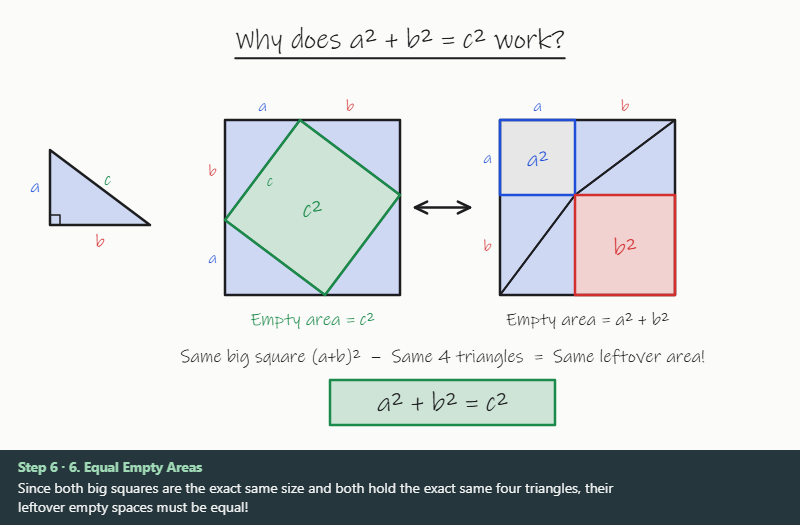

<sub>Gemini 4 Argon 证明勾股定理。模型只输出了 JSON，手写动画是播放器画出来的。3 倍速播放。</sub>

</div>

## 这是什么

「AI 老师一边讲一边在白板上写字、画图、擦除，学生还能随时打断」，看起来像某个模型的专属能力，其实不是。
它是一份很小的协议：模型把绘图指令以 JSON 流式输出，浏览器把指令播放成手写动画；学生打断时，应用把白板上现有的内容回传给模型。

所以任何大模型都可以当这个导师。这个仓库包含两样东西：

- **一套参考实现**：协议、白板播放器，以及 Claude、Gemini、DeepSeek 的运行器。
- **一份评测**：同一份提示词、同样八个教学场景（科学、数学、经济）、六个模型、两档思考、各重复三次。每一块板都在仓库里，都可以重放。

它不是一个在线的辅导产品。播放器重放的是录下来的课；要生成新的课，需要用你自己的 API 密钥跑评测运行器。

## 排行榜

<picture>
  <source media="(prefers-color-scheme: dark)" srcset="docs/assets/leaderboard-dark.svg">
  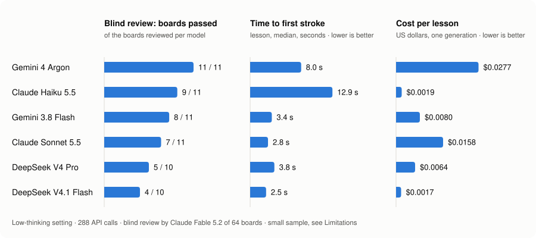
</picture>

| 模型 | 盲评通过 | 严口径 | 第一笔（讲解，p50） | 单个知识点成本 | 主要问题 |
|---|---|---|---|---|---|
| Gemini 4 Argon | **11 / 11** | 11 | 8.0 秒 | $0.0277 | 起笔最慢；2026-12-01 起官方价翻倍 |
| Claude Haiku 5.5 | 9 / 11 | 9 | 12.9 秒 | $0.0019 | 低档也会思考，所以起笔晚 |
| Gemini 3.8 Flash | 8 / 11 | 8 | 3.4 秒 | $0.0080 | 标的点不在曲线上，位置标错 |
| Claude Sonnet 5.5 | 7 / 11 | 5 | **2.8 秒** | $0.0158 | 版面最干净，但图经常和文字对不上 |
| DeepSeek V4 Pro | 5 / 10 | 4 | 3.8 秒 | $0.0064 | 文字叠在一起、盖住原图（关闭思考时） |
| DeepSeek V4.1 Flash | 4 / 10 | 4 | 2.5 秒 | $0.0017 | 24 次调用里 7 次画出空白板（关闭思考时） |

延迟和成本是低思考档的数字。「严口径」把「标出的点离真正交点 20–35 像素」的板也算不通过。
每个模型只评了 11 块板，样本很小：头尾的差距是明确的，中间几名分不出高下，见[局限](#局限)。

## 同一个问题，六个模型

「勾股定理为什么成立？」，低思考档，每个模型一块板，原样呈现。

<table>
<tr>
<td width="33%">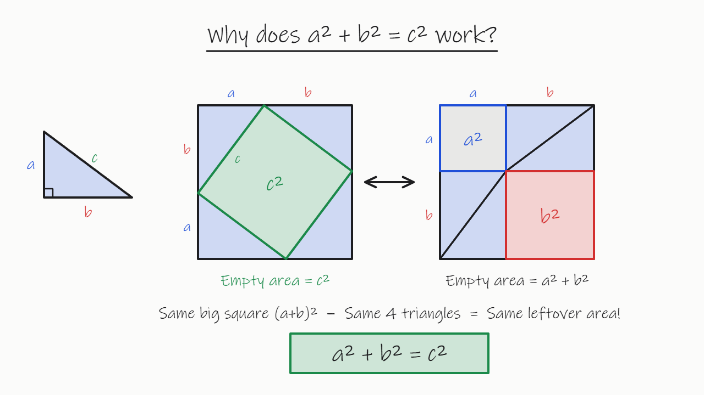<br><sub><b>Gemini 4 Argon</b> · 通过 · 两种摆法，几何精确</sub></td>
<td width="33%">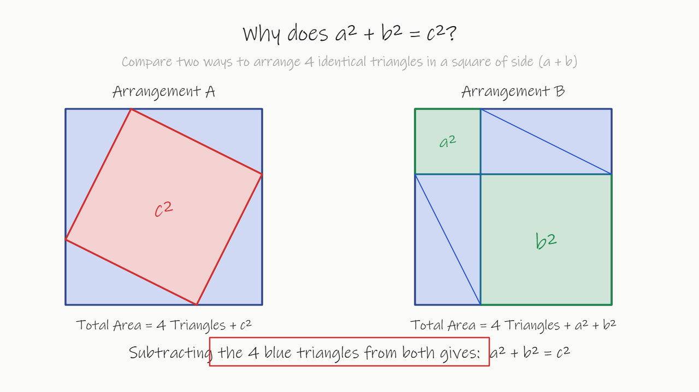<br><sub><b>Gemini 3.8 Flash</b> · 通过 · 同一个证明，高亮框放偏</sub></td>
<td width="33%">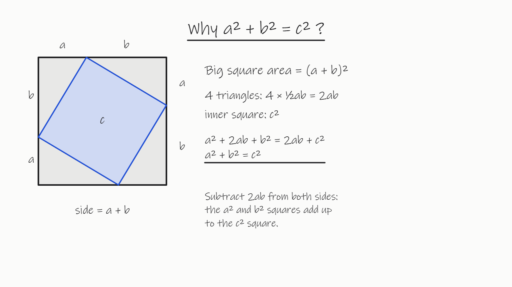<br><sub><b>Claude Haiku 5.5</b> · 通过 · 代数推导版</sub></td>
</tr>
<tr>
<td>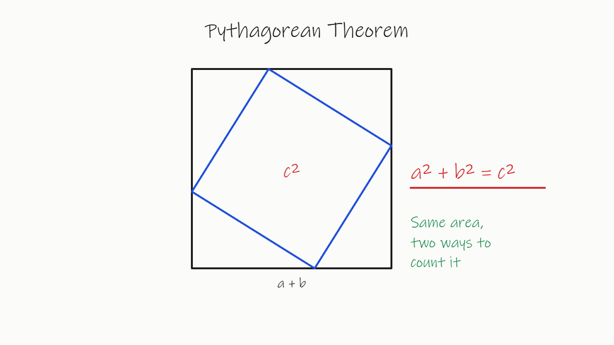<br><sub><b>Claude Sonnet 5.5</b> · 通过 · 写完推导又擦掉</sub></td>
<td>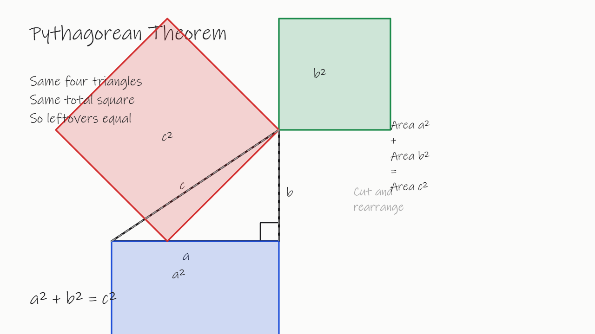<br><sub><b>DeepSeek V4 Pro</b> · 不通过 · c² 正方形没有画在斜边上，大小也不对</sub></td>
<td>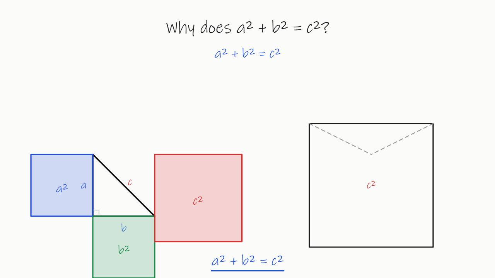<br><sub><b>DeepSeek V4.1 Flash</b> · 不通过 · 板上没有形成论证</sub></td>
</tr>
</table>

全部 64 块评审板和每块的结论、评语都在画廊里（`gallery.zh.html`，先运行 `python serve.py`）。

## 发现了什么

1. **字是对的，图是错的。** 20 块不通过的板里，12 块是因为图和文字对不上：季节标在错的地球旁，均衡点画在交点旁边而不是交点上。写在板上的文字结论几乎没有错。
2. **没有全能冠军。** Gemini 4 Argon 画得最准（11 / 11）；Claude Sonnet 5.5 起笔最快（2.8 秒）、版面最干净；Claude Haiku 5.5 比这两个便宜 8–15 倍，仍然通过 9 / 11。
3. **又快又便宜的模型，关掉思考后可能根本不按协议写。** DeepSeek V4.1 Flash 在 24 次调用里有 7 次，指令里没有 `op` 字段：JSON 能解析，但什么都画不出来。
4. **自动检查脚本是个糟糕的裁判。** 它给 64 块板里的 41 块判了「硬错误」，盲评认为其中 26 块合格。它惩罚内容丰富的图（标注贴着线），却看不出最主要的问题：图和自己的标注矛盾。
5. **多思考换来的主要是等待。** 开启思考后，Gemini 3.8 Flash 和两个 DeepSeek 模型的第一笔要等 30–120 秒，另有 23 次调用没画完就撞上了 8000 token 的输出上限。
6. **打断能接住，但接得不整洁。** 24 块打断板全部回答了学生的问题；其中 11 块把新内容压在原图上，或者把整板擦掉重来。

<table>
<tr>
<td width="33%">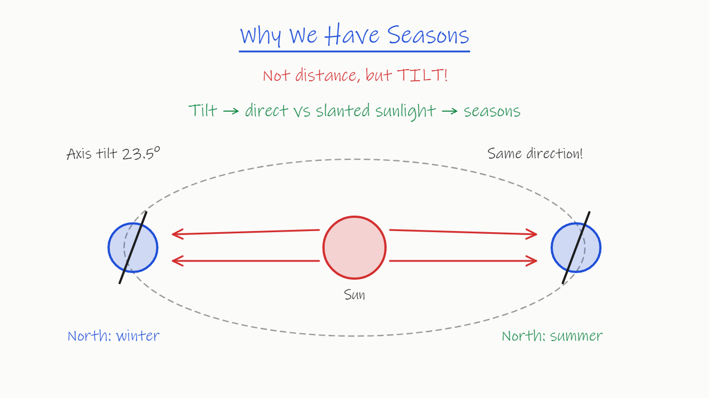<br><sub><b>标注对调。</b>北端朝向太阳的地球旁写着「北半球冬天」。（Claude Sonnet 5.5）</sub></td>
<td width="33%">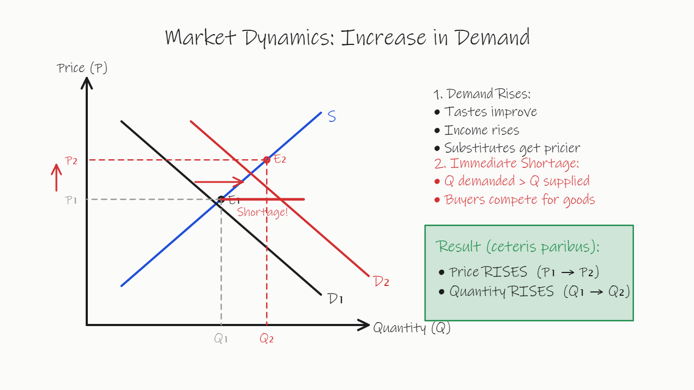<br><sub><b>点不在交点上。</b>E₂ 画在供给线上、D₂ 与 S 交点的上方，P₂ 和 Q₂ 因此读错。（Gemini 3.8 Flash）</sub></td>
<td width="33%">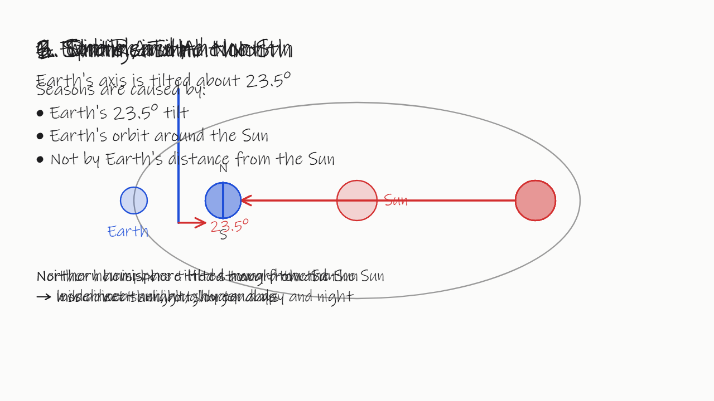<br><sub><b>叠字。</b>每一步的小标题都写在同一个位置。（DeepSeek V4 Pro）</sub></td>
</tr>
</table>

## 工作原理

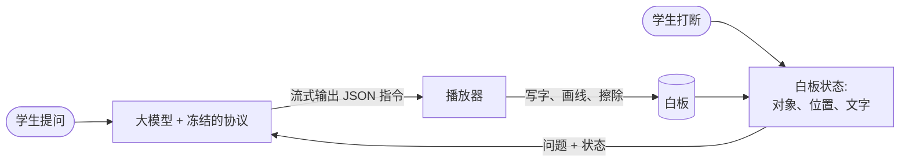

模型不碰画布。它输出若干步骤，每一步有一句旁白和一组操作：

```json
{ "title": "The tilt", "say": "Earth's axis is tilted 23.5 degrees and keeps pointing the same way.",
  "ops": [
    { "op": "erase",   "ids": ["guess", "check"] },
    { "op": "write",   "id": "key", "x": 60, "y": 128, "text": "Real reason: the axis is tilted 23.5°", "size": 36, "color": "blue" },
    { "op": "ellipse", "id": "earth1", "cx": 280, "cy": 600, "rx": 34, "ry": 34, "color": "blue", "fill": "blue" },
    { "op": "line",    "id": "axis1", "x1": 255, "y1": 657, "x2": 305, "y2": 543 } ] }
```

一共六种操作（`write`、`line`、`rect`、`ellipse`、`path`、`erase`），画在 1600 × 900 的白板上。
完整提示词见 [`protocol/PROTOCOL.md`](protocol/PROTOCOL.md)（实测用的中文原文），另有[英文译本](protocol/PROTOCOL.en.md)。
第一条指令一到就能画，所以在最快的模型上，学生 2–4 秒就能看到第一笔，远早于整节课生成完。

### 打断

<div align="center">
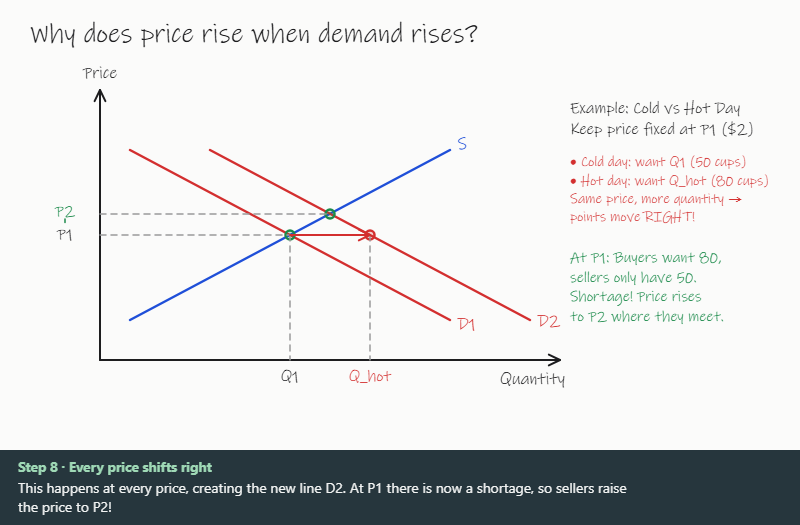
</div>

学生插话时，应用中断当前的流，把问题和白板上的内容（每个对象的 id、类型、位置、文字）一起发给模型。
模型只回新的步骤，可以按 id 擦掉或批注已有的对象。

## 怎么评的

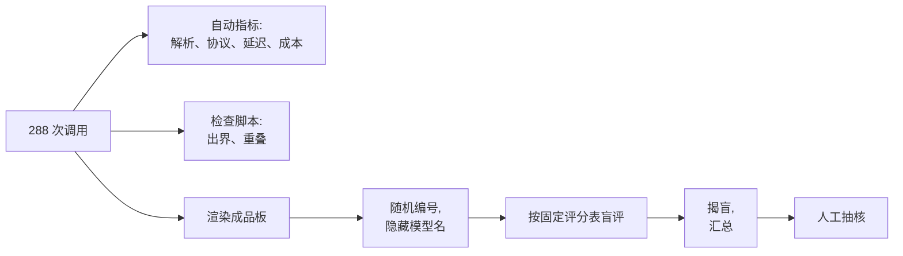

- **抽样。** 低思考档每个「模型 × 场景」取 1 块（48 块），中思考档取三个场景（16 块）。三次重复里取检查脚本结果居中的那次，不取最好的。
- **盲评。** 成品板渲染成图片并换成随机编号；打分全部落盘后才打开对应表（[`bench/blind_view.py`](bench/blind_view.py) 从不输出模型名）。
- **评分表。** 内容无科学或数学错误；图和文字一致；版面 0–2 分；讲解完整。打断场景另看：是否回答了问题；有没有压住原图或擦掉整板。通过 = 内容无错、图文一致、版面不低于 1 分。
- **评审者。** Claude Fable 5.2，不在被测模型之列。它按图上的像素位置核对几何关系（点是不是在交点上，地轴朝哪边倾）。
- **人工抽核。** `audit.html` 列出 18 块板（所有把握低或边界的，加每个模型随机一块通过板和一块不通过板）。**这一步还没有做。**

细节和复现步骤见 [`docs/METHOD.md`](docs/METHOD.md)，完整报告见 [`docs/REPORT.zh-CN.md`](docs/REPORT.zh-CN.md)（[English](docs/REPORT.md)）。

## 快速开始

看结果（不需要密钥，不需要装依赖）：

```bash
git clone https://github.com/molly554/whiteboard-ai-tutor.git
cd whiteboard-ai-tutor
python serve.py            # 然后打开 http://localhost:8811/
```

打开的是画廊，点任意一块板可以看它被写出来的过程。`player/` 还可以播放八个场景并显示检查结果。

自己跑一个模型：

```bash
pip install -r requirements.txt
# 一个 OpenRouter 密钥覆盖 Claude 和 Gemini；DeepSeek 用它自己的密钥
export OPENROUTER_API_KEY=...        # Windows: powershell -File bench/set_key.ps1 -Name OPENROUTER_API_KEY
export DEEPSEEK_API_KEY=...

python bench/run.py preflight --via openrouter                     # 免费：检查密钥、模型 ID、固定的服务商
python bench/run.py smoke --via openrouter --models sonnet-5.5     # 4 次调用，几美分
python bench/run.py main --confirm --via openrouter                # 完整矩阵，约 4 美元
python bench/aggregate.py                                          # 结果表在 results/summary.md
```

运行器把每个 OpenRouter 模型固定到官方服务商并禁止回退；有单模型和总额两道预算上限；每次调用逐条追加写入 `results/runs/*.jsonl`，中断后可以续跑。
`bench/mock_server.py` 在本机模拟三家接口，可以不花钱测试运行器。

## 仓库结构

```
protocol/      冻结的提示词（实测用的中文原文 + 英文译本）
scenarios/     8 个场景：5 个讲解，3 个打断（含固定的前文板书和白板状态）
player/        白板播放器、检查脚本、动图捕获工具（单个 HTML，无需构建）
bench/         运行器、各家接口适配、汇总、盲评辅助脚本、图表和动图生成
results/
  runs/        每一次 API 调用：耗时、token 用量、费用、原始输出
  scripts/     263 份解析成功的输出，可直接重放
  lint/        每次调用的检查结果
  review/      64 块渲染好的板、盲评打分、编号对应表、逐板评语
docs/          报告、方法、图表和动图
index.html     全部评审板的画廊（也是 GitHub Pages 的入口）
audit.html     人工抽核清单
```

## 局限

- **评审样本小。** 每个模型 11 块板，9 / 11、8 / 11、7 / 11 之间分不出高下。
- **评审是大模型做的，还没有人工核对。** 评审模型和两个被测模型同属一家厂商（结果没有偏向它们，但这不等于证明了独立）。
- **只看了最终画面。** 另外补看了 6 块板在最大一次擦除之前的画面；其余中间状态和动画节奏没有评。
- **只有一份提示词。** 协议冻结在一种写法上，而且是中文的；换一种写法，排名可能会变。
- **八个场景、三次重复。** 都是中学程度的科学、数学和经济题，说明不了真实学生问题下的表现。
- **延迟是在一台桌面电脑上测的**，Claude 和 Gemini 还多经过 OpenRouter 一跳。只适合模型之间互相比较。
- **中思考档的结果被上限截断。** 23 次调用撞上 8000 token 上限，那一档的解析成功率反映的是截断，不是能力。
- **价格会变。** 成本按 2026-11-11 的官方标价计算。

## 值得接着测的方向

- 更高层的指令（`mark_intersection(a, b)`、`label(id, text)`），让代码而不是模型去算位置。这正对着最常见的错误。
- 第二遍：把模型自己画出的板截图给它看，让它修正。
- 用视觉模型当裁判并和人工结论对照，代替检查脚本当闸门。
- 给旁白配语音，以及真正的「写到一半被打断」。

## 致谢

灵感来自 Claude Fable 5.2 发布时大家做的白板导师演示，例如
[Tyler Nishida 的黑板导师](https://runtimewire.com/article/fable-52-chalkboard-lesson-tyler-nishida)。
Whiteboard AI Tutor 是独立项目，与任何模型厂商无关。

## 许可

[MIT](LICENSE)。`results/` 里的模型输出仅用于研究和对比。
