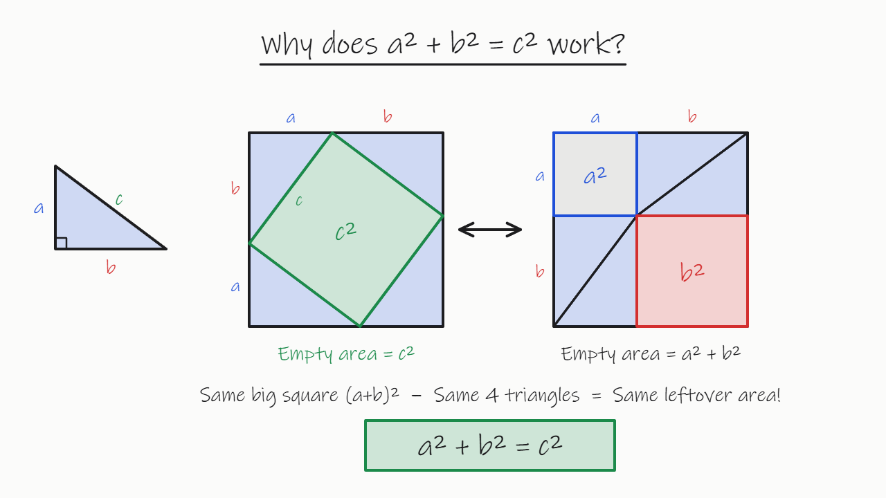
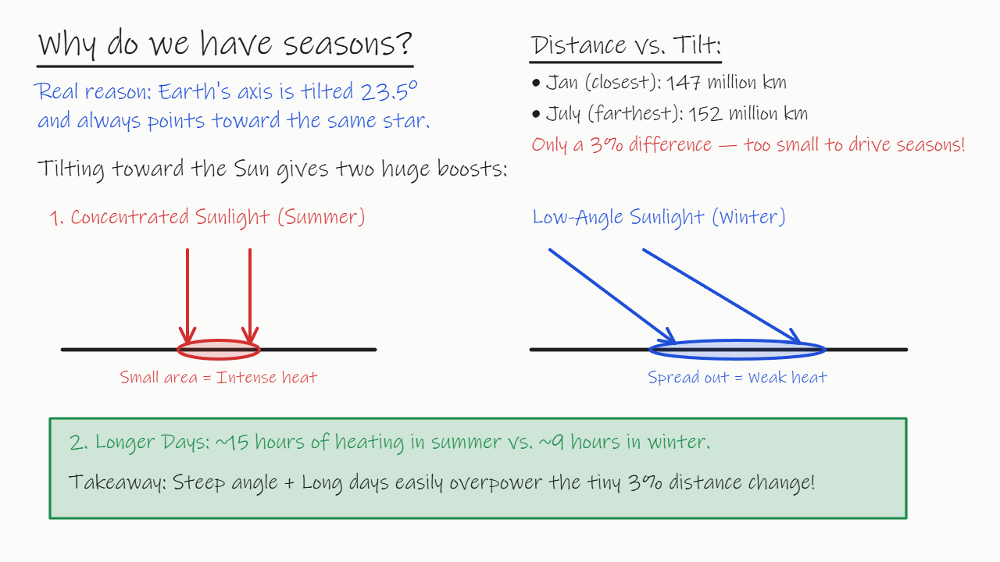
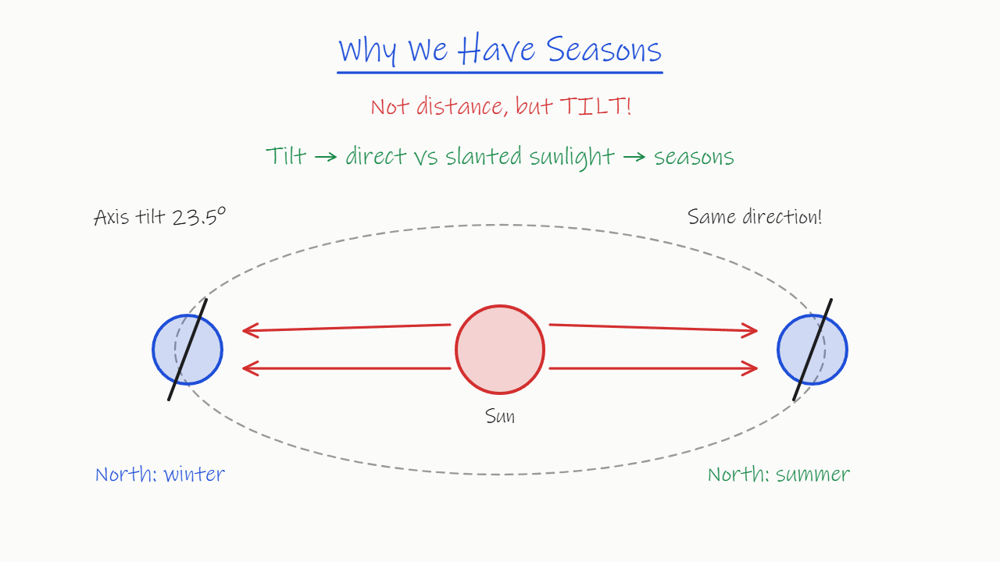
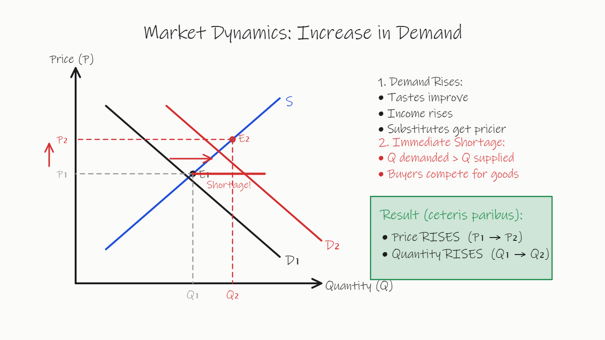
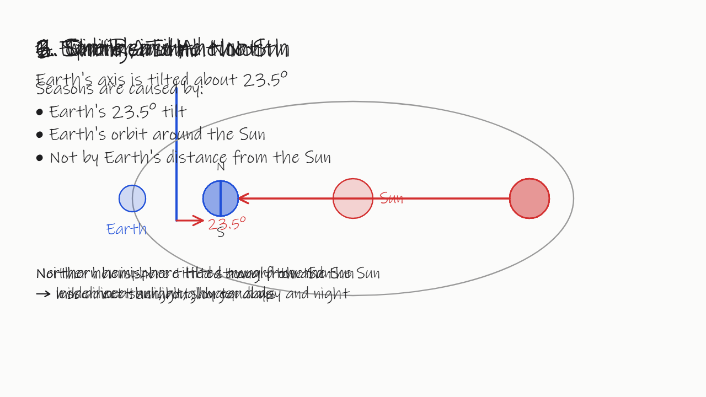

# Whiteboard AI Tutor — benchmark report

Tested 2026-11-11 · blind review by Claude Fable 5.2 · [中文版](REPORT.zh-CN.md)

## 1. Conclusions

1. **All six models can run the "model writes drawing instructions, the browser plays them as handwriting" loop, but
   quality differs a lot.** Of 64 blind-reviewed boards, 44 passed.
2. **Gemini 4 Argon drew the best boards.** All 11 sampled boards passed; its figures were the most accurate and the
   richest. It starts drawing after about 8 seconds and costs about $0.028 per lesson, and its list price doubles on
   2026-12-01.
3. **Claude Sonnet 5.5 was the fastest.** First stroke after about 2.8 seconds, cleanest layout. But 4 of its 11 boards
   had a figure that contradicted the text (seasons labelled the wrong way round, an equilibrium point drawn off the
   intersection), and 2 more were borderline.
4. **Claude Haiku 5.5 was the cheapest that still holds up.** About $0.002 per lesson and 9 of 11 boards passed, but it
   thinks even on the low setting and needs 10 seconds or more before the first stroke.
5. **DeepSeek with thinking disabled is not usable as is.** V4.1 Flash drew a blank board in 29% of calls (it ignored
   the protocol), V4 Pro often overprinted text. With thinking enabled the sampled boards were fine, but the first stroke
   took 30–120 seconds.
6. **The typical failure is not a wrong statement but a figure that disagrees with the text.** 12 of the 20 failed
   boards. The automatic linter cannot detect it.
7. **The linter is not a quality gate.** Of the 41 boards it flagged with hard errors, the blind review passed 26.

## 2. Scope

| | |
|---|---|
| Models | Claude Sonnet 5.5, Claude Haiku 5.5, Gemini 4 Argon, Gemini 3.8 Flash, DeepSeek V4 Pro, DeepSeek V4.1 Flash |
| Thinking | two settings per model. Claude and Gemini: low / medium. DeepSeek: disabled / enabled at low effort |
| Scenarios | 5 lessons (seasons, Pythagoras, a quadratic, supply and demand, photosynthesis in Chinese) + 3 student interruptions |
| Repeats | 3 per model × setting × scenario: 288 calls, all returned successfully |
| Prompt | one protocol, verbatim, not adapted per model; streamed plain-text JSON; 8,000 max tokens including thinking |
| Route | Claude and Gemini via OpenRouter pinned to the first-party provider; DeepSeek direct |
| Cost | main matrix $3.84, smoke tests $0.99, total $4.83; charges matched list price × usage |

"Low" and "mid" are not the same amount of thinking across vendors: Sonnet does not think at low, Haiku thinks about
1,700 tokens at low, Gemini 4 Argon reported 0 thinking tokens on both settings and behaved the same on both.

## 3. Blind review

Method in [METHOD.md](METHOD.md). Pass = no error, figure agrees with the text, layout at least 1 of 2 (and, for
interruptions, the question is answered). "Borderline" = a marked point 20–35 px off the true intersection: pass under
the lenient rule, fail under the strict rule.

### Per model

| Model | Boards | Pass (lenient) | Pass (strict) | Figure contradicts text | Content or figure wrong | Layout 0 | Layout mean (0–2) |
|---|---|---|---|---|---|---|---|
| Gemini 4 Argon | 11 | **11** | 11 | 0 | 0 | 0 | 1.64 |
| Claude Haiku 5.5 | 11 | 9 | 9 | 2 | 1 | 0 | 1.64 |
| Gemini 3.8 Flash | 11 | 8 | 8 | 3 | 0 | 1 | 1.36 |
| Claude Sonnet 5.5 | 11 | 7 | 5 | 4 | 0 | 0 | 1.91 |
| DeepSeek V4 Pro | 10 | 5 | 4 | 4 | 2 | 5 | 0.70 |
| DeepSeek V4.1 Flash | 10 | 4 | 4 | 5 | 3 | 4 | 0.70 |

### Low thinking, per scenario

✓ pass · △ borderline · ✗ fail. One board per cell.

| Model | Seasons | Pythagoras | Quadratic | Supply & demand | Photosynthesis | Interrupt 1 | Interrupt 2 | Interrupt 3 |
|---|---|---|---|---|---|---|---|---|
| Gemini 4 Argon | ✓ | ✓ | ✓ | ✓ | ✓ | ✓ | ✓ | ✓ |
| Claude Haiku 5.5 | ✗ | ✓ | ✓ | ✓ | ✓ | ✓ | ✓ | ✗ |
| Claude Sonnet 5.5 | ✗ | ✓ | ✓ | △ | ✓ | ✗ | ✓ | △ |
| Gemini 3.8 Flash | ✓ | ✓ | ✓ | ✗ | ✓ | ✗ | ✓ | ✗ |
| DeepSeek V4 Pro | ✗ | ✗ | ✓ | △ | ✓ | ✗ | ✗ | ✗ |
| DeepSeek V4.1 Flash | ✗ | ✗ | ✗ | ✗ | ✓ | ✗ | ✓ | ✗ |

### Medium thinking (up to 3 boards per model)

| Model | Pass / boards | Note |
|---|---|---|
| Gemini 4 Argon | 3 / 3 | no visible difference from low |
| Claude Haiku 5.5 | 3 / 3 | |
| Gemini 3.8 Flash | 3 / 3 | better than low, but the first stroke takes about 40 s |
| Claude Sonnet 5.5 | 1 / 3 | seasons labels swapped; equilibrium point off the intersection |
| DeepSeek V4 Pro | 2 / 2 | all three seasons runs truncated, nothing to review |
| DeepSeek V4.1 Flash | 2 / 2 | all three seasons runs truncated, nothing to review |

### Interruptions (24 boards)

- All 24 answered the student's question.
- 11 put new content on top of the existing drawing or wiped the board: Sonnet 2 / 4, Haiku 1 / 4, Gemini 4 Argon 1 / 4,
  Gemini 3.8 Flash 2 / 4, DeepSeek V4 Pro 3 / 4, DeepSeek V4.1 Flash 2 / 4.
- Two kinds: 5 boards wiped everything and re-taught with a new example. All 5 were clear and passed; they only break
  the protocol rule "do not redraw what is already there". The other 6 wrote over the existing figure and all failed.

## 4. Where the failed boards went wrong

20 boards failed, classified by their most serious problem:

| Problem | Boards | Where | Example |
|---|---|---|---|
| Figure contradicts text: season or direction the wrong way round | 6 | Sonnet 3, Gemini 3.8 Flash 1, DeepSeek V4 Pro 1, Haiku 1 | "North: winter" next to the Earth leaning toward the Sun; the Sun drawn outside Earth's orbit |
| Figure contradicts text: marked point not on the intersection | 6 | Gemini 3.8 Flash 2, Sonnet 1, Haiku 1, DeepSeek 1 each | new equilibrium 35–80 px away from where the lines cross, so price and quantity are read wrong |
| Layout breakdown: overprint, covering the figure | 3 | DeepSeek V4 Pro 2, DeepSeek V4.1 Flash 1 | every step title written on the same spot; a grey box over the whole chart |
| Figure itself wrong, or the relation never drawn | 3 | DeepSeek V4.1 Flash 2, DeepSeek V4 Pro 1 | the c² square not on the hypotenuse and the wrong size |
| Blank board: instructions ignore the protocol | 2 | DeepSeek V4.1 Flash 2 | operations without an `op` field, or using `type` instead |

Three more boards are borderline (Sonnet 2, DeepSeek V4 Pro 1): a marked point 23–28 px off the intersection.

Written statements were rarely wrong: across the 64 boards only two loosely worded sentences were found. Errors sit in
the figures and their labels.

## 5. Automatic metrics (288 calls)

| Model | Thinking | Parsed | Truncated at 8,000 tokens | Calls with invalid instructions | of which blank boards | Linter-clean |
|---|---|---|---|---|---|---|
| Claude Sonnet 5.5 | low | 24 / 24 | 0 | 0 | 0 | 79% |
| Claude Sonnet 5.5 | mid | 23 / 24 | 0 | 1 | 0 | 71% |
| Claude Haiku 5.5 | low | 24 / 24 | 0 | 1 | 0 | 54% |
| Claude Haiku 5.5 | mid | 22 / 24 | 2 | 0 | 0 | 62% |
| Gemini 4 Argon | low | 24 / 24 | 0 | 0 | 0 | 29% |
| Gemini 4 Argon | mid | 24 / 24 | 0 | 2 | 0 | 21% |
| Gemini 3.8 Flash | low | 24 / 24 | 0 | 1 | 0 | 25% |
| Gemini 3.8 Flash | mid | 18 / 24 | 5 | 1 | 0 | 17% |
| DeepSeek V4 Pro | low | 24 / 24 | 0 | 0 | 0 | 17% |
| DeepSeek V4 Pro | mid | 15 / 24 | 9 | 1 | 0 | 42% |
| DeepSeek V4.1 Flash | low | 24 / 24 | 0 | 9 | **7** | 8% |
| DeepSeek V4.1 Flash | mid | 17 / 24 | 7 | 0 | 0 | 33% |

- At low thinking every output from every model parsed.
- Of the 25 parse failures, 23 were thinking filling the 8,000-token cap before the JSON was finished; only 2 were real
  format errors. The medium-thinking parse rate therefore measures truncation under that cap, not formatting ability.

### Latency and cost (low thinking)

First stroke = time from the request until the first complete drawing instruction has arrived.

| Model | Lesson: first stroke p50 / p90 | Lesson: done p50 | Lesson: cost | Interruption: first stroke p50 / p90 | Interruption: cost |
|---|---|---|---|---|---|
| DeepSeek V4.1 Flash | 2.5 / 2.7 s | 6.6 s | $0.0017 | 2.3 / 3.0 s | $0.0010 |
| Claude Sonnet 5.5 | 2.8 / 3.1 s | 9.2 s | $0.0158 | 2.6 / 3.1 s | $0.0154 |
| Gemini 3.8 Flash | 3.4 / 3.8 s | 14.2 s | $0.0080 | 3.3 / 3.6 s | $0.0061 |
| DeepSeek V4 Pro | 3.8 / 4.7 s | 17.3 s | $0.0064 | 3.6 / 4.3 s | $0.0036 |
| Gemini 4 Argon | 8.0 / 9.5 s | 29.8 s | $0.0277 | 8.5 / 15.0 s | $0.0177 |
| Claude Haiku 5.5 | 12.9 / 24.4 s | 15.8 s | $0.0019 | 9.5 / 11.0 s | $0.0011 |

First stroke at medium thinking (lesson, p50): Sonnet 2.9 s, Gemini 4 Argon 7.3 s, Haiku 16.2 s, DeepSeek V4.1 Flash
28.3 s, Gemini 3.8 Flash 32.2 s, DeepSeek V4 Pro 120.9 s.

Generation outruns playback: a board takes roughly 30–50 seconds to write out at the player's speed, so what the
student waits for is mostly the first stroke.

## 6. How reliable is the linter?

| | Review: pass | Review: fail |
|---|---|---|
| Linter: clean (23 boards) | 18 | 5 |
| Linter: hard errors (41 boards) | 26 | 15 |

- Five boards the linter called clean were wrong, all with a figure that contradicts the text.
- Twenty-six boards it flagged were fine. It counts a label that touches a line, or a deliberate strike-through, as an
  error, so richer figures are hit harder. Gemini 4 Argon scored 21–29% "clean" and passed every blind review.
- The linter is only suitable for stopping two hard faults: blank or protocol-violating output, and content leaving the board.

## 7. Choosing a model

| Goal | Candidate | Measured | Trade-off |
|---|---|---|---|
| Quality first | Gemini 4 Argon, low | 11 / 11 passed | first stroke about 8 s; $0.028 per lesson, about $0.055 from December |
| Speed first | Claude Sonnet 5.5, low | first stroke about 2.8 s; cleanest layout | 4 of 11 boards with figure–text contradictions, 2 borderline; $0.016 per lesson |
| Speed first, cheaper | Gemini 3.8 Flash, low | first stroke about 3.4 s; 5 / 8 at low | equilibrium points and season labels drift; $0.008 per lesson |
| Cost first | Claude Haiku 5.5 | 9 / 11 passed; $0.002 per lesson | first stroke 10–16 s |
| Not recommended as is | either DeepSeek model, thinking off | Flash: 29% blank boards; Pro: 3 / 8 at low | with thinking on quality is acceptable but the first stroke takes 30–120 s and 30–40% of calls are truncated at 8,000 tokens |

## 8. What these results do and do not show

**They show**

- Differences between models in parse rate, protocol compliance, latency and cost under one protocol and eight
  scenarios (24 calls per cell).
- A clear quality gap between Gemini 4 Argon (11 / 11) and DeepSeek with thinking off (4–5 / 10).

**They do not show**

- The order of the models in the middle. Eleven boards per model cannot separate 9, 8 and 7 out of 11.
- What happens during the lesson. The review looked at final boards, plus six boards just before a large erase.
- That the review itself is accurate. The reviewer is an LLM from the same vendor as two tested models; the result did
  not favour them, but no human audit has been done.
- Production latency. Measured from one desktop, with an extra OpenRouter hop for Claude and Gemini.
- What medium thinking can do without the 8,000-token cap.
- Performance on real student questions, or stability beyond three repeats.
- The ranking under a differently worded protocol.
