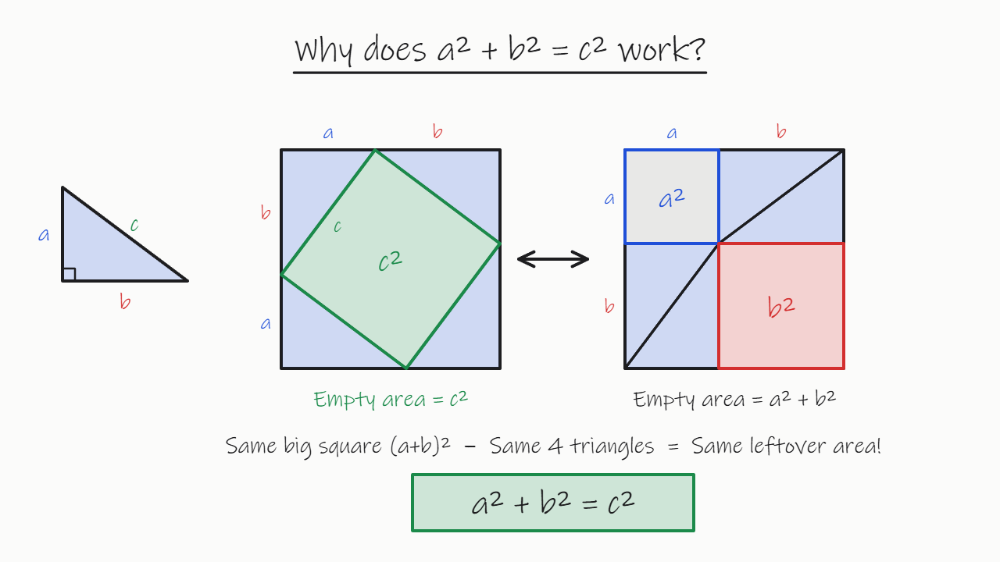
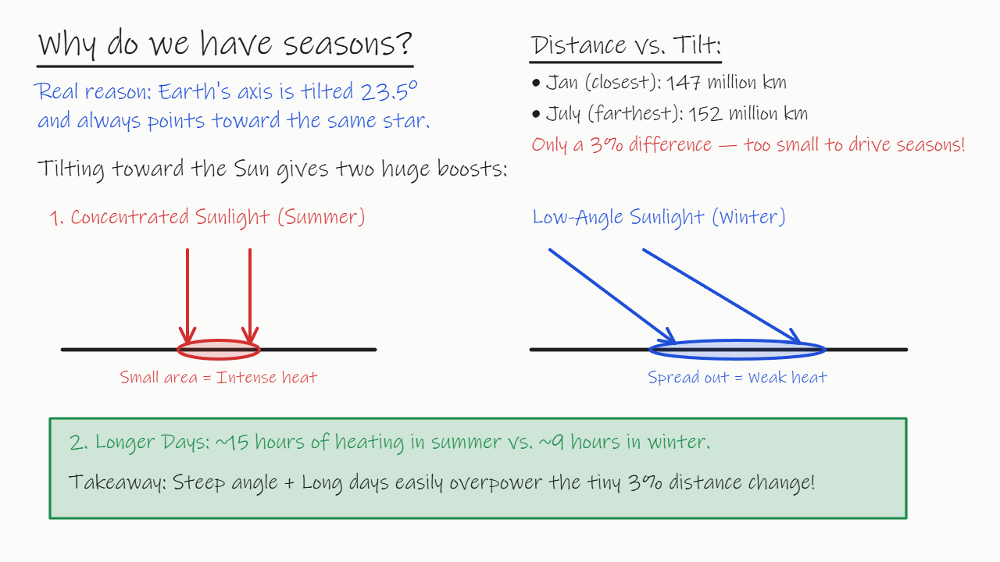
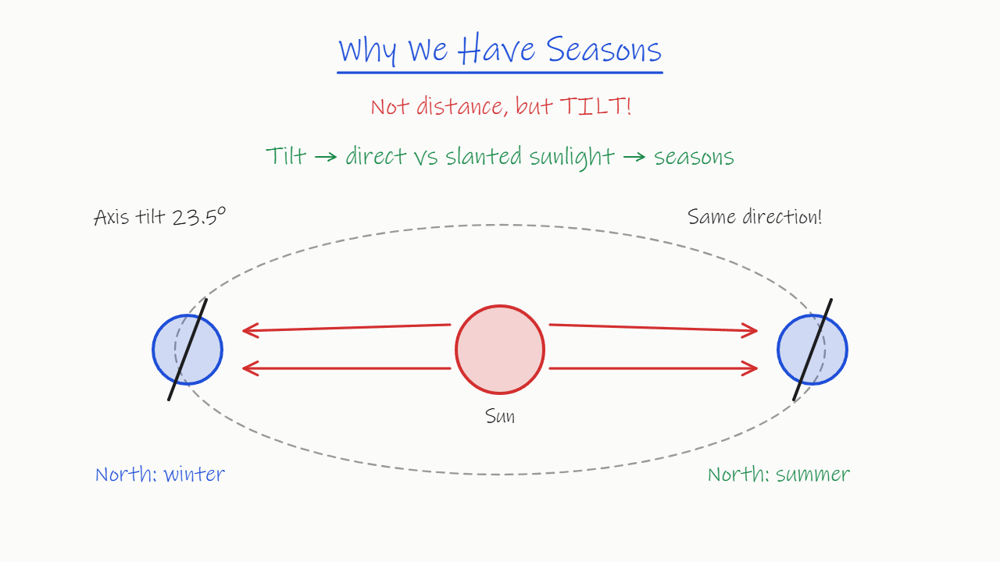
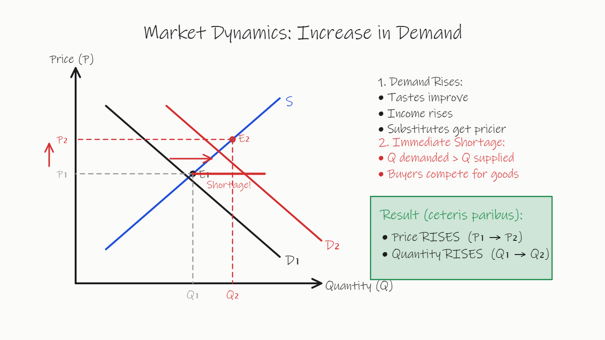
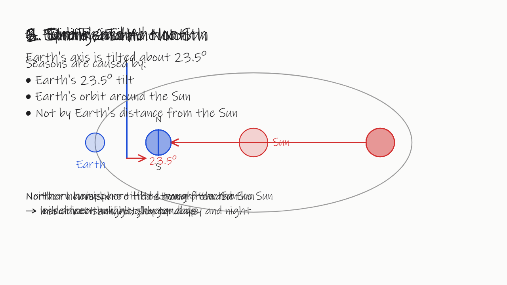

# Whiteboard AI Tutor · 跨模型实测报告

测试日期：2026-11-11　评审模型：Claude Fable 5.2（盲评）

## 一、结论

1. **这套「模型写绘图脚本、前端播放成板书」的做法，6 个模型都能跑通，但质量差距很大。** 盲评 64 块成品板，通过 44 块。
2. **Gemini 4 Argon 质量最好**：抽到的 11 块板全部通过，图画得最准、内容最丰富。代价是第一笔要等约 8 秒，单个知识点约 0.028 美元，且 12 月 1 日起官方价翻倍。
3. **Claude Sonnet 5.5 最快**：第一笔约 2.8 秒，版面最干净。但 11 块板里有 4 块「图和文字对不上」（季节标反、均衡点没画在交点上），另有 2 块在边界上。
4. **Claude Haiku 5.5 最便宜且过得去**：单个知识点约 0.002 美元，11 块过 9 块；但它在低档也会思考，第一笔要等 10 秒以上。
5. **DeepSeek 关闭思考时不可直接用**：V4.1 Flash 有 29% 的调用画出来是空白板（不按协议写指令），V4 Pro 版面经常叠字。开启思考后抽到的板质量尚可，但第一笔要等 30–120 秒。
6. **最常见的错误不是文字内容错，而是「图文不符」**：20 块不通过的板里 12 块属于这一类。自动检查脚本抓不到它。
7. **现有的自动检查脚本不适合当质量闸门**：它判「有硬错误」的 41 块板里，盲评有 26 块其实是合格的。

## 二、测了什么

| 项目 | 内容 |
|---|---|
| 模型 | Claude Sonnet 5.5、Claude Haiku 5.5、Gemini 4 Argon、Gemini 3.8 Flash、DeepSeek V4 Pro、DeepSeek V4.1 Flash |
| 思考条件 | 每个模型两档：「低」和「中」。Claude 和 Gemini 用各自的 low / medium；DeepSeek 的「低」是关闭思考，「中」是开启思考、强度 low |
| 场景 | 5 个讲解（四季、勾股定理、解方程、供需曲线、中文光合作用）+ 3 个学生打断（在四季和供需曲线的板书中途提问） |
| 重复 | 每个「模型 × 条件 × 场景」3 次，共 288 次调用，全部返回成功 |
| 提示词 | 同一份协议原文，不为任何模型改写；输出为流式纯文本 JSON，单次上限 8000 token（含思考） |
| 通道 | Claude 和 Gemini 经 OpenRouter 并固定到官方服务商；DeepSeek 直连官方接口 |
| 花费 | 主测试 3.84 美元，冒烟 0.99 美元，合计 4.83 美元；实际扣费与按官方价折算一致 |

各家的「低 / 中」不是同一个量：Sonnet 低档不思考；Haiku 低档仍平均思考约 1,700 token；Gemini 4 Argon 两档都报告 0 思考 token，两档结果也几乎一样。

## 三、盲评结果

### 怎么评的

- 每个「模型 × 场景」的低思考条件取 1 块板（3 次重复里，自动检查结果居中的那次），共 48 块；中思考条件取四季、供需曲线、打断 2 三个场景，共 16 块（DeepSeek 两个模型的中档四季 3 次都被截断，没有可评的板）。
- 成品板渲染成图片，文件名换成随机编号。评审时看不到模型名和思考条件，打分全部落盘之后才打开对应表。
- 评分项：内容有无科学或数学错误；文字与图是否对得上；版面（0–2 分）；讲解是否完整。打断场景另看是否回答了问题、新内容有没有压住原有内容或把整板擦掉。
- 通过 = 内容无错、图文一致、版面不低于 1 分（打断场景还要回答了问题）。
- 图上标的点离真正交点 20–35 像素的记为「边界」：宽口径算通过，严口径算不通过。

### 按模型

| 模型 | 评审板数 | 通过（宽口径） | 通过（严口径） | 图文不符 | 内容或图有错 | 版面 0 分 | 版面均分（满分 2） |
|---|---|---|---|---|---|---|---|
| Gemini 4 Argon | 11 | **11** | 11 | 0 | 0 | 0 | 1.64 |
| Claude Haiku 5.5 | 11 | 9 | 9 | 2 | 1 | 0 | 1.64 |
| Gemini 3.8 Flash | 11 | 8 | 8 | 3 | 0 | 1 | 1.36 |
| Claude Sonnet 5.5 | 11 | 7 | 5 | 4 | 0 | 0 | 1.91 |
| DeepSeek V4 Pro | 10 | 5 | 4 | 4 | 2 | 5 | 0.70 |
| DeepSeek V4.1 Flash | 10 | 4 | 4 | 5 | 3 | 4 | 0.70 |

### 低思考条件，逐场景

✓ 通过　△ 边界　✗ 不通过。每格只有 1 块板。

| 模型 | 四季 | 勾股定理 | 解方程 | 供需曲线 | 光合作用 | 打断 1 四季 | 打断 2 供需 | 打断 3 箭头 |
|---|---|---|---|---|---|---|---|---|
| Gemini 4 Argon | ✓ | ✓ | ✓ | ✓ | ✓ | ✓ | ✓ | ✓ |
| Claude Haiku 5.5 | ✗ | ✓ | ✓ | ✓ | ✓ | ✓ | ✓ | ✗ |
| Claude Sonnet 5.5 | ✗ | ✓ | ✓ | △ | ✓ | ✗ | ✓ | △ |
| Gemini 3.8 Flash | ✓ | ✓ | ✓ | ✗ | ✓ | ✗ | ✓ | ✗ |
| DeepSeek V4 Pro | ✗ | ✗ | ✓ | △ | ✓ | ✗ | ✗ | ✗ |
| DeepSeek V4.1 Flash | ✗ | ✗ | ✗ | ✗ | ✓ | ✗ | ✓ | ✗ |

### 中思考条件（每个模型最多 3 块）

| 模型 | 通过 / 评审板数 | 说明 |
|---|---|---|
| Gemini 4 Argon | 3 / 3 | 与低档没有可见差别 |
| Claude Haiku 5.5 | 3 / 3 | |
| Gemini 3.8 Flash | 3 / 3 | 比低档好，但第一笔要等约 40 秒 |
| Claude Sonnet 5.5 | 1 / 3 | 四季标注对调、供需均衡点偏离交点 |
| DeepSeek V4 Pro | 2 / 2 | 四季 3 次全部截断，无板可评 |
| DeepSeek V4.1 Flash | 2 / 2 | 四季 3 次全部截断，无板可评 |

### 打断场景（24 块）

- 24 块全部回答了学生的问题。
- 有 11 块把新内容压在原有内容上，或者把整板擦掉重画：Sonnet 2 / 4，Haiku 1 / 4，Gemini 4 Argon 1 / 4，Gemini 3.8 Flash 2 / 4，DeepSeek V4 Pro 3 / 4，DeepSeek V4.1 Flash 2 / 4。
- 这 11 块分两种：5 块把整板擦掉、换一个例子重讲，这 5 块都讲得清楚，全部通过，只是违反了协议里「不要重画已有内容」这一条；另外 6 块把新文字压在原图上，全部不通过。

## 四、不通过的板，错在哪

20 块不通过，按主要原因归类（一块板可能同时有几种问题，按最严重的算）：

| 问题 | 块数 | 出现在 | 例子 |
|---|---|---|---|
| 图文不符：季节或方向标反 | 6 | Sonnet 3，Gemini 3.8 Flash 1，DeepSeek V4 Pro 1，Haiku 1 | 北端朝向太阳的地球旁写着「北半球冬天」；太阳画在地球轨道外面 |
| 图文不符：标的点不在交点上 | 6 | Gemini 3.8 Flash 2，Sonnet 1，Haiku 1，DeepSeek 各 1 | 新均衡点画在供给线上，离真正的交点 35–80 像素，价格和数量因此读错 |
| 版面崩坏：叠字、盖住原图 | 3 | DeepSeek V4 Pro 2，DeepSeek V4.1 Flash 1 | 每一步的小标题写在同一位置；灰色方框盖住整张图 |
| 图本身画错，或没画出要讲的关系 | 3 | DeepSeek V4.1 Flash 2，DeepSeek V4 Pro 1 | 勾股定理里 c² 正方形没有画在斜边上，大小也不对 |
| 空白板：不按协议写指令 | 2 | DeepSeek V4.1 Flash 2 | 指令里没有 `op` 字段，或写成 `type` |

另有 3 块边界板（Sonnet 2，DeepSeek V4 Pro 1）：标的点离交点 23–28 像素。

文字内容本身出错的情况很少：64 块板里，写在板上的文字结论只发现 2 处措辞不严，错误几乎都出在图和图上的标注。

几块有代表性的板：

## 五、自动指标（288 次调用）

### 全部调用

| 模型 | 条件 | 解析成功 | 被 8000 上限截断 | 指令不合协议的调用 | 其中整板空白 | 检查脚本无硬错误 |
|---|---|---|---|---|---|---|
| Claude Sonnet 5.5 | 低 | 24 / 24 | 0 | 0 | 0 | 79% |
| Claude Sonnet 5.5 | 中 | 23 / 24 | 0 | 1 | 0 | 71% |
| Claude Haiku 5.5 | 低 | 24 / 24 | 0 | 1 | 0 | 54% |
| Claude Haiku 5.5 | 中 | 22 / 24 | 2 | 0 | 0 | 62% |
| Gemini 4 Argon | 低 | 24 / 24 | 0 | 0 | 0 | 29% |
| Gemini 4 Argon | 中 | 24 / 24 | 0 | 2 | 0 | 21% |
| Gemini 3.8 Flash | 低 | 24 / 24 | 0 | 1 | 0 | 25% |
| Gemini 3.8 Flash | 中 | 18 / 24 | 5 | 1 | 0 | 17% |
| DeepSeek V4 Pro | 低 | 24 / 24 | 0 | 0 | 0 | 17% |
| DeepSeek V4 Pro | 中 | 15 / 24 | 9 | 1 | 0 | 42% |
| DeepSeek V4.1 Flash | 低 | 24 / 24 | 0 | 9 | **7** | 8% |
| DeepSeek V4.1 Flash | 中 | 17 / 24 | 7 | 0 | 0 | 33% |

- 低思考条件下，6 个模型的输出全部能解析。
- 25 次解析失败里，23 次是思考把 8000 token 的上限占满，JSON 没写完；真正的格式错误只有 2 次。所以中档的解析成功率反映的是「8000 上限下的截断率」，不是模型的格式能力。

### 延迟和成本（低思考条件）

第一笔 = 从发出请求到第一个完整绘图指令到达。

| 模型 | 讲解：第一笔 p50 / p90 | 讲解：生成完 p50 | 讲解：单次成本 | 打断：第一笔 p50 / p90 | 打断：单次成本 |
|---|---|---|---|---|---|
| DeepSeek V4.1 Flash | 2.5 / 2.7 秒 | 6.6 秒 | $0.0017 | 2.3 / 3.0 秒 | $0.0010 |
| Claude Sonnet 5.5 | 2.8 / 3.1 秒 | 9.2 秒 | $0.0158 | 2.6 / 3.1 秒 | $0.0154 |
| Gemini 3.8 Flash | 3.4 / 3.8 秒 | 14.2 秒 | $0.0080 | 3.3 / 3.6 秒 | $0.0061 |
| DeepSeek V4 Pro | 3.8 / 4.7 秒 | 17.3 秒 | $0.0064 | 3.6 / 4.3 秒 | $0.0036 |
| Gemini 4 Argon | 8.0 / 9.5 秒 | 29.8 秒 | $0.0277 | 8.5 / 15.0 秒 | $0.0177 |
| Claude Haiku 5.5 | 12.9 / 24.4 秒 | 15.8 秒 | $0.0019 | 9.5 / 11.0 秒 | $0.0011 |

中思考条件下的第一笔（讲解，p50）：Sonnet 2.9 秒，Gemini 4 Argon 7.3 秒，Haiku 16.2 秒，DeepSeek V4.1 Flash 28.3 秒，Gemini 3.8 Flash 32.2 秒，DeepSeek V4 Pro 120.9 秒。

- 生成比播放快：按播放器的速度，一块板的书写动画要放约 30–50 秒（在本地验证阶段的脚本上实测为 27–54 秒），所以用户感受到的等待主要是「第一笔」那几秒。
- Gemini 4 Argon 和 Carbon 的官方价 2026-12-01 起翻倍，Gemini 3.8 Flash 2027-01-01 起翻倍，表里是当前价。

## 六、自动检查脚本的可靠性

把盲评的 64 块板和检查脚本的结果对照：

| | 盲评通过 | 盲评不通过 |
|---|---|---|
| 检查脚本无硬错误（23 块） | 18 | 5 |
| 检查脚本有硬错误（41 块） | 26 | 15 |

- 检查脚本说「干净」的板，仍有 5 块不合格，都是图文不符，它看不出来。
- 检查脚本说「有硬错误」的板，26 块其实合格。它把「标注贴着线」「故意的划掉线」都算成错误，图越丰富被误伤越多。Gemini 4 Argon 就是这样：检查脚本只给它 21%–29% 的「干净率」，盲评却是全部通过。
- 检查脚本只适合拦截两类硬伤：整板空白或指令不合协议、内容画出白板。

## 七、选型参考

按目标列出，数字来自上面各表。

| 目标 | 候选 | 实测 | 代价 |
|---|---|---|---|
| 质量优先 | Gemini 4 Argon，低档 | 11 / 11 通过 | 第一笔约 8 秒；单知识点 $0.028，12 月起约 $0.055 |
| 速度优先 | Claude Sonnet 5.5，低档 | 第一笔约 2.8 秒；版面最干净 | 11 块里 4 块图文不符、2 块边界；单知识点 $0.016 |
| 速度优先、更便宜 | Gemini 3.8 Flash，低档 | 第一笔约 3.4 秒；低档 5 / 8 通过 | 均衡点、季节标注容易画偏；单知识点 $0.008 |
| 成本优先 | Claude Haiku 5.5 | 9 / 11 通过；单知识点 $0.002 | 第一笔 10–16 秒 |
| 不建议直接使用 | DeepSeek 两个模型，关闭思考 | Flash 低档 29% 空白板；Pro 低档 3 / 8 通过 | 开思考后质量尚可，但第一笔 30–120 秒，且 8000 上限下 3–4 成被截断 |

## 八、这些结果的可信范围

**能说明的**

- 同一份协议、同样 8 个场景下，各模型在解析成功率、协议遵循、延迟、成本上的差异（每格 24 次调用）。
- 抽样板的质量差异：Gemini 4 Argon 11 / 11 与 DeepSeek 4–5 / 10 之间的差距是明确的。

**不能说明的**

- 中间几个模型的排序。每个模型只评了 11 块板，9 / 11、8 / 11、7 / 11 之间的差别不足以分出高下。
- 板书过程中的画面。评审看的是每块板的最终画面，另外补看了 6 块板在大面积擦除之前的画面；其余中间状态和动画节奏没有看。
- 评审本身的准确性。评审模型 Fable 5.2 与 Sonnet、Haiku 同属一家厂商；结果并没有偏向这两个模型，但人工核对还没有做。
- 上线后的延迟。延迟是在一台开发机上测的，Claude 和 Gemini 还多经过 OpenRouter 一跳，只有模型之间的相对差异可靠。
- 中思考档的真实能力。8000 token 的上限让 23 次调用被截断。
- 真实学生问题下的表现，以及 3 次重复之外的稳定性。
- 协议换一种写法后的排名。协议是冻结的一版，可能对某些模型更友好。

## 九、材料位置

| 内容 | 位置 |
|---|---|
| 全部评审板（按模型分组，可点开播放动画） | `gallery.zh.html`（先运行 `python serve.py`） |
| 人核清单（18 块：把握低和边界的 7 块 + 每个模型随机抽的通过板和不通过板） | `audit.html` |
| 逐板打分和评语 | `results/review/summary_review.md` |
| 每次调用的原始记录（耗时、用量、费用、原始输出） | `results/runs/main-or.jsonl`、`results/runs/main-ds.jsonl` |
| 自动指标汇总 | `results/summary.md` |
| 评测方法和复现步骤 | [`docs/METHOD.md`](METHOD.md) |
| 协议原文 | [`protocol/PROTOCOL.md`](../protocol/PROTOCOL.md) |
